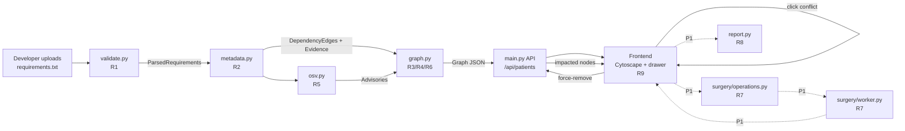
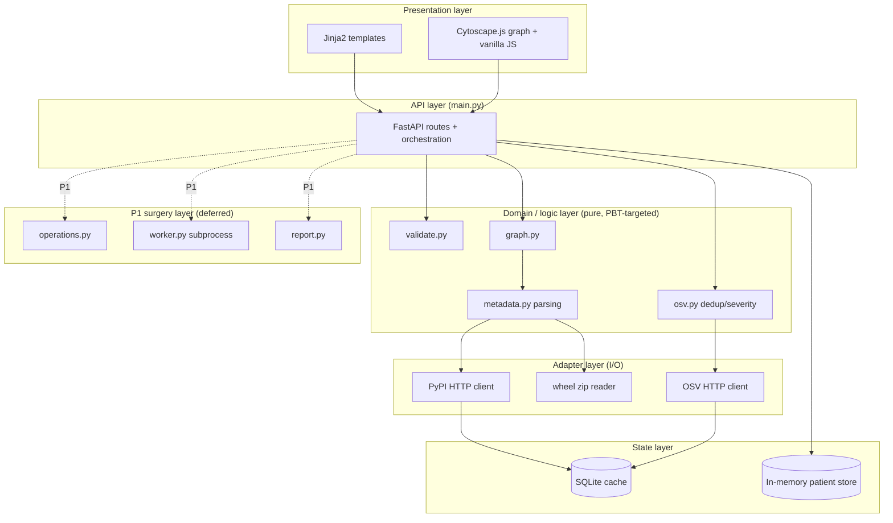
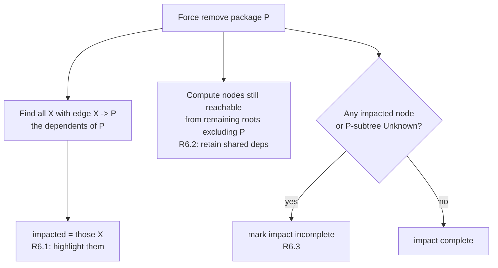
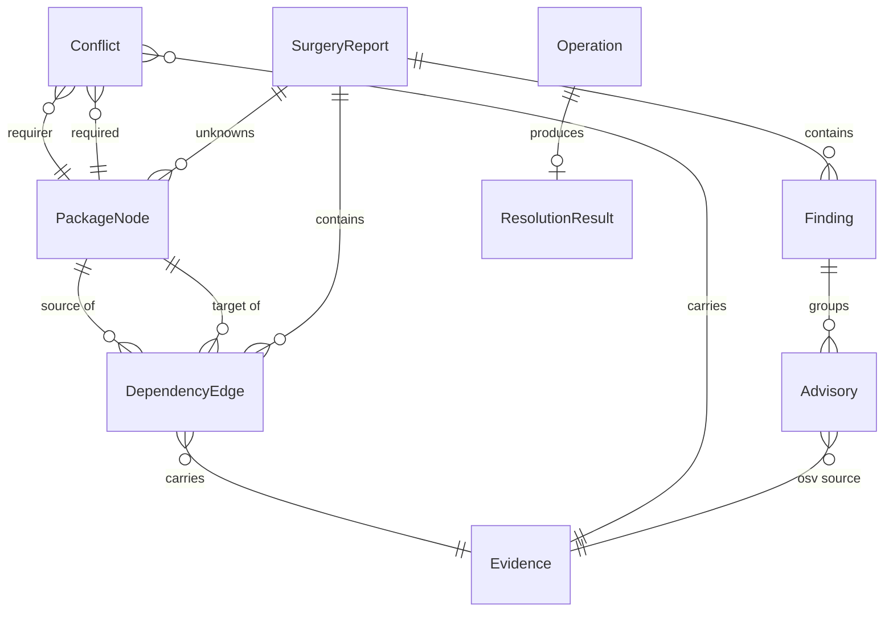
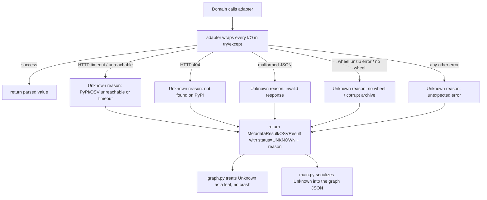

# Design Document — PostMortem 2.0

## Introduction

This design refines `docs/plan/03-architecture-draft.md` and `docs/research/PostMortem_3_Deep_Research_Build_Blueprint_2026-11-23.md` into a buildable specification for the PostMortem dependency surgery lab. It traces every component, data model, and API endpoint back to the requirements in `requirements.md` (R1–R9) and the correctness properties (P1–P8).

**Scope of this design:**
- **P0 (R1–R6, R9)** is designed in full detail.
- **P1 (R7 Simulation, R8 Surgical Report)** is designed at the interface level — enough that the data models and API surface won't need rework when those tasks arrive, but without full implementation detail. **Property P7 is P1-deferred** because it depends on R7; P1–P6 and P8 are P0.

**Design principles carried from the requirements:**
1. Evidence over assumptions — every dependency edge and finding carries a recorded source.
2. Simulation over promises — a resolver success means constraints are satisfiable, never "your app will run".
3. Unknown is never green — missing metadata is a distinct status, never healthy.
4. Decoration serves decision — every visual effect encodes a data value.

## Overview

### System context

PostMortem 2.0 is a single-process Python web application that lets a developer upload a `requirements.txt`, inspect the resulting dependency graph rendered as a gothic autopsy table, drill into the evidence behind each dependency edge and finding, and (P1) simulate dependency changes before editing their repository. It targets one fixed environment (CPython 3.12, Linux x86_64) so every graph reflects what would actually be installed there rather than every possible environment.

The application is built for the Kiroween 2026 Costume Contest: the gothic visuals must make the app *more useful*, not just decorated, so every visual state is derived from a data value (status, conflict, uncertainty) defined in `requirements.md`'s Visual Language table.

### User journey → component mapping



The P0 journey is: upload → validate → build declared graph (metadata + OSV) → render patient → click a conflict/finding → open evidence drawer → force-remove a package → see blast radius. P1 extends this with: choose an operation → run isolated resolver → see exact diff + outcome → compare candidates → export report. The dashed lines mark P1 work that this design accounts for at the interface level only.

### External dependencies

| Service | Endpoint | Use | Requirement |
|---|---|---|---|
| PyPI JSON API | `GET https://pypi.org/pypi/{name}/{version}/json` | Read `info.requires_dist` and locate wheel download URLs | R2.1, R2.2, R2.9 |
| PyPI file storage | wheel download URL from the JSON `releases` block | Download wheel zip to read `.dist-info/METADATA` | R2.2 |
| OSV API | `POST https://api.osv.dev/v1/querybatch` | Batch vulnerability lookup | R5.1 |
| OSV API | `GET https://api.osv.dev/v1/vulns/{id}` | Fetch full advisory detail per record id | R5.1, R5.3 |
| pip (P1) | subprocess `pip install --dry-run --report` | Isolated constraint resolution | R7.2 |

Research findings that shape the design:
- The PyPI JSON `releases` block is being deprecated in favor of the PEP 691 simple API, but for the P0 pinned-version lookup it remains the supported source for `requires_dist` and wheel file URLs. ([PyPI JSON docs](https://docs.pypi.org/api/), [index API](https://docs.pypi.org/api/index-api/))
- OSV `querybatch` returns only `{id, modified}` per vuln, in input order, supports up to 1000 queries per batch, and paginates when a single query returns >1000 vulns or the whole batch returns >3000. Detail must be fetched per id. Aliases (CVE, GHSA, PYSEC) refer to the same underlying vulnerability and must be deduplicated. ([OSV querybatch](https://google.github.io/osv.dev/post-v1-querybatch/), [OSV FAQ](https://google.github.io/osv.dev/faq/))
- `pip install --dry-run --report -` emits a stable JSON report (`version: "1"`) with an `install[]` array whose items carry `metadata.requires_dist`, `metadata.version`, `download_info.url`, and an `environment` object of PEP 508 marker values. ([pip installation report](https://pip.pypa.io/en/stable/reference/installation-report/))

## Architecture

### Stack

- **Runtime:** Python 3.12. **Web:** FastAPI + Jinja2 templates, Uvicorn. **Dependencies:** `uv`.
- **Logic:** `packaging` (`Requirement`, `SpecifierSet`, `Marker`, `Version`, `canonicalize_name`), `networkx` (graph), `httpx` (HTTP client).
- **Cache:** SQLite (R2.5). **Frontend:** server-rendered HTML/CSS + minimal vanilla JS, Cytoscape.js for the graph.
- **Tests:** `pytest` + Hypothesis (property-based testing).
- **Hosting:** Render free web service (sleeps when idle; warm before judging). Ephemeral storage means the SQLite cache is a performance aid, not a source of truth.

### Module layout

```
app/
  main.py            FastAPI routes + orchestration (all P0 endpoints, P1 endpoints stubbed)
  validate.py        R1 input validator (pure functions)
  metadata.py        R2 PyPI JSON -> wheel METADATA -> Unknown (HTTP + zip parsing)
  graph.py           R3 declared graph, R4 conflict detection, R6 force remove (pure over recovered metadata)
  osv.py             R5 OSV batch + details + alias dedup + severity (HTTP)
  cache.py           R2.5 SQLite cache
  models.py          Pydantic models for every data structure
  surgery/
    operations.py    R7 build edited manifest + exact diff (P1, interface only here)
    worker.py        R7 isolated pip dry-run (P1, interface only here)
  report.py          R8 surgical report export (P1, interface only here)
  templates/         Jinja2 (upload page, autopsy page)
  static/            CSS, Cytoscape.js bundle, minimal JS
tests/
  unit/              example-based tests
  property/          Hypothesis property tests (P1-P6, P8)
samples/             legacy_flask_requests.txt (demo patient)
```

### Layered architecture



The domain layer (`validate.py`, `graph.py`, and the pure parsing portions of `osv.py`/`metadata.py`) holds the logic that property-based tests target. The adapter layer isolates all network and filesystem I/O so failures never escape as exceptions into the domain layer (R2.10).

### Module responsibility → requirement tracing

| Module | Responsibility | Requirements | Properties |
|---|---|---|---|
| `validate.py` | Parse manifest against narrow PEP 508 subset; reject dangerous constructs; enforce size/line limits; normalize names; detect duplicates; flag unpinned | R1.1–R1.6 | P1, P2 |
| `metadata.py` | Recover `requires_dist` from PyPI JSON → wheel METADATA → Unknown; record evidence source; honor unpinned skip; handle all failure modes | R2.1–R2.11 | (feeds P6 via status) |
| `graph.py` | Build declared graph; evaluate markers for one target env; drop unrequested extras; detect conflicts; force-remove impact; assign statuses | R3.1–R3.3, R4.1–R4.2, R6.1–R6.3 | P3, P4, P5, P6 |
| `osv.py` | OSV querybatch + per-id detail; alias dedup; severity derivation; unknown-severity handling | R5.1–R5.6 | P8 |
| `cache.py` | SQLite cache for PyPI + OSV responses | R2.5 | — |
| `models.py` | Typed models for nodes, edges, evidence, conflicts, advisories, operations, results, reports | All | — |
| `main.py` | FastAPI routes, orchestration, session store, sample loader | All P0; P1 stubs | — |
| `surgery/operations.py` | Build edited manifest + exact line diff for remove_pin / force_remove / set_pin | R7.1, R7.5 | P7 (P1) |
| `surgery/worker.py` | Isolated pip dry-run resolver with fixed environment, binary-only, timeout | R7.2–R7.4 | — |
| `report.py` | Export Markdown + JSON surgical report | R8.1 | — |
| Frontend (`static/`, `templates/`) | Data-driven gothic graph, evidence drawer, keyboard nav, reduced motion, contrast | R9.1–R9.3 | — |

## Components and Interfaces

### `validate.py` (R1)

A pure module: string in, structured result out, no I/O. This makes it the primary PBT target.

**Interface:**
```
validate_manifest(text: str) -> ValidationResult
    where ValidationResult = {
        requirements: list[ParsedRequirement],
        errors: list[ValidationError],   # each carries line number + reason
        rejected: bool                    # true if file rejected entirely (size/line limit)
    }
    ParsedRequirement = {
        canonical_name: str,              # PEP 503 normalized (R1.4)
        extras: list[str],
        specifier: SpecifierSet,          # from packaging
        marker: Marker | None,
        pinned: bool,                     # true iff single '==' clause (R1.6)
        raw_line: str,
        line_number: int,
    }
```

**Processing order (each step maps to a requirement):**

1. **Byte size check (R1.3).** If `len(text.encode()) > 64 * 1024` → reject the file; record the limit error. No further parsing.
2. **Line count check (R1.3).** Count non-comment, non-blank lines; if `> 200` → reject the file.
3. **Per-line parse (R1.1, R1.2).** For each line:
   - Strip inline comments (split at the first `#` that is not inside a quoted marker — package names, specifiers, and markers never contain a bare `#`, so the first `#` reliably begins a comment). Blank/whitespace-only lines are accepted and skipped (R1.1 allows comments and blank lines).
   - **Dangerous-construct rejection (R1.2):** if the stripped line starts with `-` → reject as a pip option (`-r`, `-c`, `-e`, `--…`). Then parse with `packaging.requirements.Requirement.parse`; if the parsed object has a non-`None` `.url` attribute → reject as a URL/VCS/local-path requirement. These two checks cover URLs, VCS (`git+…`), local paths, editable installs, and pip options without concatenating raw text into anything executable.
   - **Grammar (R1.1):** accept only `name[extras] specifier [; marker]`. If `Requirement.parse` raises → record a parse error with the line number.
4. **Normalization (R1.4).** `canonicalize_name(req.name)` → PEP 503 normalized. `Flask`, `flask`, `FLASK` collapse to one key.
5. **Duplicate detection (R1.5).** Track canonical names in a set; a repeat → duplicate error naming both occurrences.
6. **Unpinned detection (R1.6).** A requirement is exactly pinned iff its `SpecifierSet` contains exactly one specifier whose operator is `==`. Any other specifier (`>=`, `~=`, `<`, bare name, `!=`, `===`) → `pinned = False`. The caller (`graph.py`) then treats unpinned nodes as Unknown.

**Design decisions and rationale:**
- Reusing `packaging`'s parser avoids hand-rolling PEP 508 and keeps marker/specifier semantics correct for free. The "narrow subset" is enforced *after* parsing by rejecting any result with a URL and by the dangerous-construct pre-check, rather than by writing a new grammar.
- Normalization is performed in `validate.py` (not later) so duplicate detection and all downstream lookups use one canonical key. This is what makes P1 (idempotent normalization) testable at the system boundary.

### `metadata.py` (R2)

Recovers the dependency edges of a pinned package, with a strict fallback chain and exhaustive failure handling. The HTTP fetching is in the adapter layer; the `requires_dist`/METADATA parsing is pure.

**Interface:**
```
recover_dependencies(req: ParsedRequirement, cache: Cache) -> MetadataResult
    where MetadataResult = {
        edges: list[DependencyEdge],          # each carries Evidence
        status: NodeStatus,                   # HEALTHY / UNKNOWN / ...
        unknown_reason: str | None,           # set when status is UNKNOWN
        evidence: Evidence,                    # source of this node's own metadata
    }
```

**Recovery flow (R2.1 → R2.3 fallback chain):**

```mermaid
flowchart TD
    P{Pinned ==version?} --|no| UNK1[Unknown: unpinned<br/>skip metadata + OSV<br/>R1.6 / R2.6]
    P -->|yes| J[GET PyPI JSON<br/>name/version]
    J -->|reachable & found| H{requires_dist<br/>present?}
    H -->|yes| EDG1[Parse requires_dist<br/>evidence = pypi-json<br/>R2.1 / R2.4]
    H -->|empty / missing| W[Find bdist_wheel URL<br/>download + read .dist-info/METADATA<br/>never execute package code<br/>R2.2]
    W -->|wheel exists| EDG2[Parse Requires-Dist lines<br/>evidence = wheel-metadata<br/>R2.2 / R2.4]
    W -->|no wheel| UNK2[Unknown: no wheel<br/>R2.3]
    J -->|unreachable / timeout| UNK3[Unknown: PyPI unreachable/timeout<br/>R2.7]
    J -->|not found on PyPI| UNK4[Unknown: not found on PyPI<br/>R2.9]
    EDG1 & EDG2 --> OK[status = HEALTHY]
    UNK1 & UNK2 & UNK3 & UNK4 --> UNKS[status = UNKNOWN + reason<br/>R2.11: never healthy]
```

**Requirement-by-requirement handling:**

- **R2.1:** For a pinned `name==version`, `GET https://pypi.org/pypi/{name}/{version}/json`; read `info.requires_dist` (a list of PEP 508 strings). Each becomes a `DependencyEdge` with `evidence.source = "pypi-json"`.
- **R2.2:** If `requires_dist` is missing or empty, locate a `bdist_wheel` entry in the JSON `releases[version]` list (filter `packagetype == "bdist_wheel"`), download the wheel, and read `{name}-{version}.dist-info/METADATA` from the zip without executing any package code. Parse the `Requires-Dist:` headers (RFC 822-style, multiple allowed). Evidence source = `wheel-metadata`.
- **R2.3:** If no wheel file exists for the version → the package's dependencies are Unknown. Evidence source = `unknown`.
- **R2.4:** Every edge records an `Evidence` with `source ∈ {"pypi-json", "wheel-metadata", "unknown"}` plus the URL and `fetched_at`. (`osv` and `pip-report` sources are used by other modules.)
- **R2.5:** All PyPI JSON and OSV responses go through `cache.py` (below).
- **R2.6:** Unpinned nodes are detected in `validate.py`; `metadata.py` short-circuits and returns Unknown without any network call, so no metadata or OSV fetch occurs for them.
- **R2.7:** PyPI unreachable or timeout → `status = UNKNOWN`, `unknown_reason = "PyPI unreachable"` or `"PyPI timeout"`.
- **R2.8:** OSV unreachable/timeout → handled in `osv.py`: vulnerability status Unknown with reason.
- **R2.9:** Package/version not present on PyPI (HTTP 404) → Unknown, `unknown_reason = "not found on PyPI"`.
- **R2.10:** **All** network/parse failures are caught in the adapter layer and converted into Unknown results. No exception from fetching, parsing, or unzip ever propagates to `main.py`; the system always returns a result. This is the single most important robustness guarantee and is tested directly (see Testing Strategy).
- **R2.11:** An Unknown node's `status` is the enum value `UNKNOWN`, which is distinct from `HEALTHY` by construction in `models.py`. The status model (below) makes "Unknown as healthy" unrepresentable.

**Wheel METADATA parsing detail:** A wheel is a zip; the metadata file path is `{normalized_name}-{version}.dist-info/METADATA`. The file uses email-header format. `Requires-Dist` lines (there may be many, and continuation lines are rare for this field) each hold one PEP 508 requirement string, e.g. `Requires-Dist: urllib3 (<1.24,>=1.21.1)`. These are parsed with `packaging.requirements.Requirement` to extract name, specifier, and marker — the same parse path used by `validate.py`, ensuring consistent semantics.

### `graph.py` (R3, R4, R6)

Builds the declared graph from parsed requirements and recovered metadata, evaluates it for one target environment, detects conflicts, and computes force-remove impact. Pure over the recovered metadata, so it is a PBT target for P3–P6.

**Target environment (R3.1):** A single fixed marker environment dict, displayed in the UI:

```
TARGET_ENV = {
    "python_version": "3.12",
    "python_full_version": "3.12.0",
    "implementation_name": "cpython",
    "platform_python_implementation": "CPython",
    "platform_system": "Linux",
    "platform_machine": "x86_64",
    "sys_platform": "linux",
    "os_name": "posix",
    "extra": "",   # no extras requested by default
}
```

**Interfaces:**
```
build_declared_graph(
    roots: list[ParsedRequirement],
    metadata_lookup: Callable[[ParsedRequirement], MetadataResult],
) -> DeclaredGraph

detect_conflicts(graph: DeclaredGraph) -> list[Conflict]

force_remove(graph: DeclaredGraph, package: str) -> ForceRemoveResult
```

**Declared graph construction:**
1. Roots are the manifest requirements. Build a `networkx.DiGraph` with edge direction `requirer -> required` (A requires B).
2. For each pinned root, call `metadata_lookup` to get its dependency edges. For each edge:
   - **Marker evaluation (R3.1):** evaluate `edge.marker` against `TARGET_ENV` via `packaging.markers.Marker.evaluate(env)`. If the marker does not apply, drop the edge. (Unpinned nodes have no edges.)
   - **Extras (R3.2):** an edge guarded by `extra == 'X'` is kept only if `X` was requested by the user. P0 requests no extras, so all extras-guarded edges are dropped. The marker `evaluate` against `extra == ""` already returns False for any non-empty extra, which implements this.
   - Recurse into transitive dependencies: pinned transitives get their own metadata; unpinned or Unknown transitives become leaf Unknown nodes (no further recursion).
3. **Status assignment (R3.3, R2.11):** each node gets a `NodeStatus`:
   - `UNKNOWN` if metadata could not be recovered (any reason) or if unpinned.
   - `CONFLICT` if the node is involved in a detected conflict.
   - `VULNERABLE` if it has known OSV findings.
   - `HEALTHY` if pinned, metadata recovered, no conflicts, no OSV findings.
   - An Unknown node is never assigned `HEALTHY` — enforced by the enum.

**Conflict detection (R4.1, R4.2):**
For each edge `A -> B` carrying specifier `S`, if `B` is pinned to version `V` (recorded on the node) and `V` does not satisfy `S`, create a `Conflict(requirer=A, required=B, specifier=S, pinned_version=V, evidence=edge.evidence)`. The satisfiability check uses `SpecifierSet.__contains__` (`S.contains(V)`), matching `packaging`'s own semantics exactly — this is what P5 validates against. R4.2 (torn artery rendering) is a frontend concern; `graph.py` only emits the conflict record.

**Force Remove (R6.1–R6.3):**


- **R6.1:** `impacted` is exactly the set of nodes with a direct edge to P (the dependents). These are highlighted as "declares P as a requirement". P3 asserts this set is only ever direct dependents.
- **R6.2:** Force Remove removes only node P from the graph. Any dependency still reachable from a remaining root is retained — it is never removed just because P also needed it. This prevents orphaning shared transitive dependencies.
- **R6.3:** If any impacted dependent is Unknown, or any node in P's subtree is Unknown, the result is marked `incomplete = True` with the list of unknown nodes, because the full blast radius cannot be determined.

### `osv.py` (R5)

Queries OSV in batch, fetches detail per id, deduplicates aliases, and derives severity strictly from documented fields.

**Interface:**
```
query_vulnerabilities(packages: list[(canonical_name, version)], cache: Cache) -> OSVResult
    where OSVResult = {
        per_package: dict[(name, version), PackageVulns],
    }
    PackageVulns = {
        raw_count: int,                # number of OSV records returned (R5.2)
        dedup_count: int,              # after alias dedup (R5.2)
        advisories: list[Advisory],    # raw records
        findings: list[Finding],       # deduplicated findings
        unknown_reason: str | None,    # if OSV unreachable/timeout (R2.8)
    }
```

**Query flow (R5.1):**
1. Build a `querybatch` request: `{"queries": [{"package": {"name": name, "ecosystem": "PyPI"}, "version": version}]}`. Chunk at ≤1000 queries per request (the service limit) and merge results in input order.
2. The response `results` aligns positionally with the input queries; each entry has `vulns: [{id, modified}]` and an optional `next_page_token`. Follow pagination for any entry that returns a token (re-request just those queries with the token).
3. For each distinct vuln `id`, `GET /v1/vulns/{id}` to fetch the full record (aliases, `database_specific.severity`, `severity` CVSS array, `affected`, modified time, URL).
4. Cache both the batch id lists and the per-id detail (R2.5).

**Alias deduplication (R5.2, P8):**
Each OSV record has an `id` and an optional `aliases` list (other IDs for the same vulnerability). Two records describe the same finding if they share any ID. Deduplication uses union-find over the set of all IDs (each record's `id` plus its `aliases`): connected components are the deduplicated findings. `raw_count` = total records; `dedup_count` = number of components. Every raw `id` maps to exactly one component (P8), and `dedup_count ≤ raw_count` always holds.

**Severity derivation (R5.3, R5.5, R5.6):**
```
derive_severity(record) -> (label, source)
    if record.database_specific.severity present:
        return (record.database_specific.severity, "database_specific.severity")   # R5.3
    elif record.severity (CVSS array) present:
        map CVSS score -> label (LOW/MODERATE/HIGH/CRITICAL per CVSS v3 bands)       # R5.3
        return (label, "cvss")
    else:
        return ("severity unknown", "none")                                          # R5.5
```
- **R5.5:** No severity and no CVSS → label is `"severity unknown"`, never `"critical"`.
- **R5.6:** Severity is read *only* from `database_specific.severity` or a CVSS score. No other field is consulted; no inference. The `source` field records which one was used so the evidence drawer can show it.
- **R5.4:** The "no OSV record" case (empty `vulns`) is a distinct state from "safe". The API result and the UI both use the label "No known OSV records found" / "no OSV record does not mean safe", never "safe".

**Failure handling (R2.8, R2.10):** OSV unreachable or timeout → `unknown_reason` set, `raw_count`/`dedup_count` not computed, status treated as Unknown. Any HTTP/parse error is caught and converted to Unknown; no exception propagates.

### `models.py`

Defines the typed models every other module shares. The `NodeStatus` enum is the linchpin for the "Unknown is never green" principle.

```
class EvidenceSource(str, Enum):
    PYPI_JSON = "pypi-json"
    WHEEL_METADATA = "wheel-metadata"
    OSV = "osv"
    PIP_REPORT = "pip-report"      # P1
    UNKNOWN = "unknown"

class NodeStatus(str, Enum):
    HEALTHY = "healthy"
    CONFLICT = "conflict"
    VULNERABLE = "vulnerable"
    UNKNOWN = "unknown"           # covers unpinned, unreachable, not-found, no-wheel

class Evidence(BaseModel):
    source: EvidenceSource
    url: str | None
    fetched_at: datetime

class PackageNode(BaseModel):
    id: str                        # canonical_name (graph node key)
    canonical_name: str
    requested_spec: str             # original specifier text
    pinned: bool                    # R1.6
    pinned_version: Version | None # set only when pinned
    is_root: bool
    status: NodeStatus              # R3.3, R2.11
    unknown_reason: str | None      # R2.7-R2.9 reasons
    evidence: Evidence | None

class DependencyEdge(BaseModel):
    source: str                     # requirer canonical_name
    target: str                     # required canonical_name
    specifier: str                  # R4.1
    marker: str | None
    marker_applies: bool            # R3.1 evaluation result
    evidence: Evidence               # R2.4

class Conflict(BaseModel):          # R4.1
    requirer: str
    required: str
    specifier: str
    pinned_version: Version
    evidence: Evidence

class Advisory(BaseModel):          # R5
    osv_id: str
    aliases: list[str]
    modified_at: datetime
    severity_label: str             # R5.3 / R5.5
    severity_source: str            # R5.6: which field supplied it
    url: str

class Finding(BaseModel):           # R5.2 deduplicated
    ids: list[str]                  # all raw ids in this equivalence class
    advisories: list[Advisory]
    severity_label: str
    severity_source: str

class Operation(BaseModel):          # P1 — R7
    kind: Literal["remove_pin", "force_remove", "set_pin"]
    package: str
    new_spec: str | None             # for set_pin

class ResolutionResult(BaseModel):   # P1 — R7.2-R7.4
    ok: bool
    resolved: dict[str, str] | None   # name -> version
    error: str | None                 # R7.3 conflict message
    environment: dict[str, str]       # from pip report
    raw_report_path: str | None
    label: str                        # "Constraints satisfied - runtime not tested" (R7.4)

class SurgeryReport(BaseModel):      # P1 — R8.1
    patient_id: str
    findings: list[Finding]
    edges: list[DependencyEdge]
    unknowns: list[PackageNode]
    evidence: list[Evidence]
    timestamp: datetime
```

**The status invariant (R2.11, R3.3, P6):** `NodeStatus` is a closed enum. An Unknown node's status is the `UNKNOWN` value, which is a different enum member from `HEALTHY`. The model cannot express "Unknown and healthy" — it would require a single field to hold two enum values. This makes P6 a structural guarantee rather than a runtime check.

### `cache.py` (R2.5)

A SQLite-backed cache for PyPI JSON and OSV responses, accessed only through the adapter layer.

**Schema:**
```
pypi_metadata(canonical_name TEXT, version TEXT, payload JSON, fetched_at TIMESTAMP, status TEXT, PRIMARY KEY (canonical_name, version))
osv_batch(canonical_name TEXT, version TEXT, vuln_ids JSON, fetched_at TIMESTAMP, PRIMARY KEY (canonical_name, version))
osv_detail(osv_id TEXT PRIMARY KEY, payload JSON, fetched_at TIMESTAMP)
```

**Design decisions:**
- **TTL-based freshness:** entries older than a configurable TTL (default 24h) are re-fetched. The TTL is a *freshness* control, not a correctness control — a cached value is always structurally valid because it was valid when stored.
- **Never cache failures as success:** error/Unknown results are cached with a short TTL and a `status` flag so a transient outage doesn't poison the cache for a day. A 404 ("not found on PyPI", R2.9) is cached as a durable Unknown (the package genuinely isn't there); a timeout (R2.7) is cached with a short TTL so a later retry can succeed.
- **Render ephemeral storage:** on the Render free tier the filesystem is wiped on spin-down. The cache improves latency for a warm session but is not relied on for persistence; a cold start simply re-fetches. This is acceptable because correctness comes from live fetches, not from the cache.
- **Cache key uses the canonical name** (from R1.4 normalization), so casing variations hit the same row.

### Frontend (`templates/`, `static/`) (R9)

Server-rendered HTML with a Cytoscape.js graph and minimal vanilla JS. No SPA framework — the product brief and research both advise against elaborate React architecture for an 11-day build.

**Data-driven visual classes (R9.1):** The API returns each node with a `status` and each edge with its type. The frontend maps these to CSS classes derived *only* from data, implementing the Visual Language table:

| Data (from API) | CSS class | Visual |
|---|---|---|
| `status=healthy` | `node-healthy` | calm pale organ |
| `status=conflict` | `node-conflict` | red artery styling |
| `status=vulnerable` | `node-vuln`, pulse speed from severity | green infection glow; unknown severity = grey, never "critical" |
| `status=unknown` | `node-unknown` | fog/mist, label "Unknown: no evidence" |
| edge + conflict | `edge-conflict` | torn red artery |
| edge + unknown evidence | `edge-unknown` | dotted amber |
| overall state | `heartbeat` | heartbeat monitor at top |

Every class name comes from a data field; no visual state is hard-coded. This is what makes R9.1 testable: the rendered class set is a pure function of the API payload.

**Evidence drawer (R9.1, R5.4):** Clicking (or keyboard-activating) a node or edge opens a side drawer showing its `Evidence` (source, URL, fetched_at), any `Conflict` details, and any `Advisory`/`Finding` records with severity and source. For an Unknown node the drawer shows the `unknown_reason` and the label "Unknown: no evidence". An empty OSV result shows "No known OSV records found — no OSV record does not mean safe" (R5.4).

**Keyboard navigation (R9.3):** The graph container is a focusable region. Tab moves focus between nodes in document order; Enter/Space activates the evidence drawer; Escape closes it. The upload form, force-remove control, and drawer are all reachable and operable without a pointer. A skip-to-graph link and visible focus rings are provided.

**Reduced motion and contrast (R9.2):** A `prefers-reduced-motion` media query disables the pulse and heartbeat animations, replacing them with static states that preserve the same information (severity shown via a static glow color and a text label; overall state shown via a static icon). All text meets contrast ≥ 4.5:1 against the charcoal background; status is never conveyed by color alone (every color class is paired with a text label/icon), so the decoration stays accessible and degrades gracefully.

### P1 components — interface-level design (R7, R8)

These are designed so their data models and API contracts are fixed now; implementation is deferred to separate tasks.

**`surgery/operations.py` (R7.1, R7.5):**
```
build_edited_manifest(original: list[ParsedRequirement], op: Operation) -> EditedManifest
    # remove_pin: delete the line for op.package
    # set_pin: replace the specifier for op.package with op.new_spec
    # force_remove: no manifest change (graph-only op); returns original
compute_diff(original: list[ParsedRequirement], edited: EditedManifest) -> list[DiffLine]
    # exact line diff: added / removed / unchanged, with line numbers
```
- R7.1: the diff is exact and line-level. P7 (P1) asserts that applying the diff to the original yields the edited manifest exactly.
- R7.5: the comparison view composes up to three `Operation` results side by side.

**`surgery/worker.py` (R7.2–R7.4):**
```
run_resolver(edited_manifest: EditedManifest, timeout: int = 60) -> ResolutionResult
```
- R7.2: runs `pip install --dry-run --ignore-installed --only-binary=:all: --python-version 3.12 --platform manylinux2014_x86_64 --target <tmpdir> --report -` as a subprocess with a fixed 60s timeout, no installation, binary distributions only.
- R7.3: on failure, the resolver's conflict message is extracted and returned as `error`.
- R7.4: on success, resolved versions and OSV before/after are returned with the label `"Constraints satisfied - runtime not tested"`.

**Security constraints (apply now to the design, enforced at P1 build time):**
- The pip argument list is built in code from parsed, allowlisted requirement objects — never from raw uploaded text. Run with `shell=False`, a cleared environment (no inherited env vars leaking secrets), a fixed PyPI index, a private temp `--target` directory, a non-root identity, and a hard timeout.
- `--only-binary=:all:` ensures no `setup.py`/build hook ever runs (no sdist execution).
- Uploaded files are never stored beyond the session; the temp target dir is cleaned up after each run; no secrets appear in logs or in the redacted resolver output.
- The research blueprint notes a process inside the web container is not strong isolation; if a sufficiently isolated worker isn't feasible on free hosting, the hosted demo falls back to clearly-labelled recorded/snapshot resolver cases, and full live resolution is offered via local container setup. The design's `ResolutionResult` already carries `label` so this fallback needs no model change.

**`report.py` (R8.1):**
```
export_report(patient, operations: list[Operation] | None) -> tuple[str, str]   # (markdown, json)
```
- R8.1: the report contains every finding with its evidence and all unknowns. Markdown and JSON forms are produced from the same underlying `SurgeryReport` model so they cannot diverge.

## API Design

All endpoints are JSON over HTTP, served by FastAPI. P0 endpoints are fully specified; P1 endpoints are marked and stubbed in the initial build.

### `POST /api/patients` — upload + validate (P0)

**Request:** `multipart/form-data` with field `file` (the `requirements.txt`), **or** `application/json` `{ "text": "..." }`.

**Response `200`:**
```json
{
  "patient_id": "uuid",
  "requirements": [{"canonical_name": "flask", "extras": [], "specifier": "==2.0.1", "marker": null, "pinned": true, "line_number": 1}],
  "errors": [{"line_number": 4, "reason": "URL not allowed"}],
  "rejected": false,
  "summary": {"requirement_count": 12, "pinned_count": 10, "unpinned_count": 2}
}
```
**Response `400` (R1.3 rejection):** `{"rejected": true, "errors": [{"reason": "file exceeds 64 KB"}]}`

**Traces:** R1.1–R1.6 (validation), creates the patient that R2–R6 operate on. Validation errors are returned, not raised, so the UI can name the offending line (R1.2).

### `GET /api/patients/{id}` — declared graph (P0)

**Response `200`:**
```json
{
  "target_environment": {"python_version": "3.12", "platform_system": "Linux", "platform_machine": "x86_64"},
  "nodes": [{"id": "flask", "canonical_name": "flask", "requested_spec": "==2.0.1", "pinned": true, "pinned_version": "2.0.1", "is_root": true, "status": "conflict", "unknown_reason": null, "evidence": {"source": "pypi-json", "url": "...", "fetched_at": "..."}}],
  "edges": [{"source": "flask", "target": "urllib3", "specifier": "<1.24,>=1.21.1", "marker": null, "marker_applies": true, "evidence": {"source": "pypi-json", "url": "...", "fetched_at": "..."}}],
  "conflicts": [{"requirer": "requests", "required": "urllib3", "specifier": "<1.24,>=1.21.1", "pinned_version": "1.24.1", "evidence": {"source": "pypi-json", "url": "...", "fetched_at": "..."}}],
  "unknowns": [{"id": "markupsafe", "reason": "no wheel"}],
  "vulnerabilities": {"flask": {"raw_count": 2, "dedup_count": 1, "findings": [{"ids": ["GHSA-...", "CVE-..."], "severity_label": "HIGH", "severity_source": "database_specific.severity"}]}}
}
```
**Traces:** R2 (metadata + evidence on edges/nodes), R3 (target environment, marker_applies, statuses), R4 (conflicts array), R5 (vulnerabilities with raw/dedup counts and severity source), R3.3/R2.11 (unknowns array; an Unknown node appears here, never in a "healthy" position).

### `POST /api/patients/{id}/force-remove` — blast radius (P0)

**Request:** `{"package": "urllib3"}`

**Response `200`:**
```json
{
  "impacted": [{"package": "requests", "evidence": {"source": "pypi-json", "url": "...", "fetched_at": "..."}}],
  "retained_shared": ["flask"],
  "incomplete": true,
  "unknown_involved": ["markupsafe"]
}
```
**Traces:** R6.1 (impacted = direct dependents), R6.2 (retained_shared = shared deps still reachable from other roots), R6.3 (incomplete + unknown_involved when Unknown nodes are involved).

### `POST /api/patients/{id}/operations` — simulate (P1, stubbed)

**Request:** `{"kind": "set_pin", "package": "urllib3", "new_spec": "==1.21.1"}`

**Response `200`:**
```json
{
  "diff": [{"line": 3, "type": "removed", "text": "urllib3==1.24.1"}, {"line": 3, "type": "added", "text": "urllib3==1.21.1"}],
  "resolution": {"ok": true, "resolved": {"urllib3": "1.21.1"}, "error": null, "environment": {"python_version": "3.12"}, "label": "Constraints satisfied - runtime not tested"},
  "osv_before": {"urllib3": {"raw_count": 1, "dedup_count": 1}},
  "osv_after": {"urllib3": {"raw_count": 0, "dedup_count": 0}}
}
```
**Traces:** R7.1 (diff), R7.2–R7.4 (resolution + label), R7.5 (the client composes up to three of these for comparison).

### `GET /api/patients/{id}/report.md` and `/report.json` — surgical report (P1, stubbed)

**Traces:** R8.1 (Markdown + JSON, every finding + evidence + unknowns).

### API → requirement traceability

| Endpoint | P0/P1 | Requirements |
|---|---|---|
| `POST /api/patients` | P0 | R1.1–R1.6 |
| `GET /api/patients/{id}` | P0 | R2.1–R2.11, R3.1–R3.3, R4.1–R4.2, R5.1–R5.6 |
| `POST /api/patients/{id}/force-remove` | P0 | R6.1–R6.3 |
| `POST /api/patients/{id}/operations` | P1 | R7.1–R7.5 |
| `GET /api/patients/{id}/report.md` / `.json` | P1 | R8.1 |

## Data Models

The Pydantic models in `models.py` (above) are the canonical data structures. This section summarizes the field-level requirement traceability and the key relationships.

### Model → requirement traceability

| Model | Key fields | Requirements served |
|---|---|---|
| `Evidence` | `source` (enum of 5), `url`, `fetched_at` | R2.4 (every edge/finding has a source), R5 (OSV evidence) |
| `PackageNode` | `canonical_name`, `pinned`, `pinned_version`, `status`, `unknown_reason`, `evidence` | R1.4 (canonical name), R1.6/R2.6 (pinned/Unpinned), R2.7–R2.9 (unknown_reason), R2.11/R3.3 (status distinct from healthy) |
| `DependencyEdge` | `source`, `target`, `specifier`, `marker`, `marker_applies`, `evidence` | R2.1–R2.4 (edge + evidence), R3.1 (marker_applies), R4.1 (specifier for conflict) |
| `Conflict` | `requirer`, `required`, `specifier`, `pinned_version`, `evidence` | R4.1 (full conflict record with evidence) |
| `Advisory` | `osv_id`, `aliases`, `severity_label`, `severity_source` | R5.1 (id + aliases), R5.3/R5.5 (severity_label), R5.6 (severity_source) |
| `Finding` | `ids`, `advisories`, `severity_label` | R5.2 (dedup grouping; raw ids preserved) |
| `Operation` | `kind`, `package`, `new_spec` | R7.1 (operation kinds) |
| `ResolutionResult` | `ok`, `resolved`, `error`, `environment`, `label` | R7.2–R7.4 (resolver outcome + honest label) |
| `SurgeryReport` | `findings`, `edges`, `unknowns`, `evidence` | R8.1 (every finding + evidence + unknowns) |

### Relationship diagram



The graph is stored in memory as a `networkx.DiGraph` whose node attributes are `PackageNode` values and whose edge attributes are `DependencyEdge` values. The patient store (`SESSION`) maps `patient_id -> DeclaredGraph` for the life of the session only — no persistence beyond the session (security constraint).


## Correctness Properties

*A property is a characteristic or behavior that should hold true across all valid executions of a system — essentially, a formal statement about what the system should do. Properties serve as the bridge between human-readable specifications and machine-verifiable correctness guarantees.*

PostMortem's logic layer (`validate.py`, `graph.py`, the pure parsing parts of `metadata.py`/`osv.py`) is composed of pure functions over large input spaces — parsers, normalizers, graph operations, conflict comparison, and alias deduplication. This makes the system well suited to property-based testing. Properties P1–P6 and P8 are P0 and validated with Hypothesis; **P7 is P1-deferred** because it depends on the R7 simulation worker. Additional P0 properties P9–P14 are derived in this design from acceptance criteria not already covered by the verbatim properties; they were consolidated during prework reflection to remove redundancy (R3.1+R3.2 → P11; R5.3+R5.5+R5.6 → P12).

### P0 properties

### Property 1: Name normalization is idempotent

*For any* package-name string, normalizing it twice yields the same result as normalizing it once: `norm(norm(x)) == norm(x)`. The normalized form is the PEP 503 canonical name used as the deduplication and lookup key everywhere downstream.

**Validates: Requirements 1.4**

### Property 2: The validator never accepts a dangerous line

*For any* requirements line that contains a pip option (`-r`, `-c`, `-e`, `--…`), a URL, a VCS reference, or a local path, the validator SHALL reject it and name the offending line number. The validator accepts only lines in the narrow `name[extras] specifier [; marker]` grammar (plus comments and blank lines).

**Validates: Requirements 1.1, 1.2**

### Property 3: Force Remove of P affects only packages with an edge to P

*For any* declared graph and any package P, force-removing P highlights exactly the set of nodes that have a direct edge to P (the packages that declare P as a requirement), and affects no other node's membership.

**Validates: Requirements 6.1**

### Property 4: Removing one root never removes a dependency still required by another root

*For any* declared graph and any root R, removing R (force-remove) retains every dependency that is still reachable from at least one remaining root. A shared transitive dependency is never orphaned simply because R also required it.

**Validates: Requirements 6.2**

### Property 5: Conflict detection agrees with the reference specifier semantics

*For any* specifier S and pinned version V, the conflict detector flags a conflict if and only if `packaging.specifiers.SpecifierSet.contains(S, V)` is False. When a conflict is flagged, the record carries the requirer, the required package, the specifier, the pinned version, and the evidence source.

**Validates: Requirements 4.1**

### Property 6: An Unknown node never receives a healthy status

*For any* node whose metadata is Unknown — including unpinned nodes (R1.6), packages not found on PyPI (R2.9), unreachable/timeout cases (R2.7/R2.8), and no-wheel packages (R2.3) — the node's `status` SHALL be `UNKNOWN`, never `HEALTHY`. The closed `NodeStatus` enum makes this unrepresentable.

**Validates: Requirements 1.6, 2.11, 3.3**

### Property 8: OSV deduplication is sound and complete over aliases

*For any* set of OSV records returned for a package, the deduplicated count is less than or equal to the raw count, and every raw record id maps to exactly one deduplicated finding (no id is dropped and no id appears in two findings). Records sharing any alias id collapse into one finding.

**Validates: Requirements 5.2**

### Property 9: The narrow-grammar parser round-trips

*For any* requirement line that conforms to the accepted narrow grammar (`name[extras] specifier [; marker]`), parsing it and then re-serializing the parsed structure and parsing again yields an equivalent requirement. The parser accepts every valid line and produces a structure with the correct name, extras, specifier, and marker.

**Validates: Requirements 1.1**

### Property 10: Duplicate detection keys on canonical names

*For any* two requirement lines whose package names normalize to the same PEP 503 canonical name (e.g. `Flask` and `FLASK`), the validator SHALL report them as the same package (a duplicate), and two lines with distinct canonical names SHALL never be reported as duplicates.

**Validates: Requirements 1.4, 1.5**

### Property 11: Edge inclusion reflects the target environment

*For any* dependency edge carrying a marker and/or an extra guard, the edge is included in the declared graph if and only if its marker evaluates true against the single recorded target environment (CPython 3.12, Linux x86_64) and its extra (if any) was requested. Edges guarded by unrequested extras are dropped; marker evaluation is deterministic against the fixed environment.

**Validates: Requirements 3.1, 3.2**

### Property 12: Severity is derived only from documented fields with documented precedence

*For any* OSV record, the severity label is derived from `database_specific.severity` if present, else from a CVSS score if present, else labeled `"severity unknown"` (never `"critical"`). The severity source recorded on the finding is one of exactly `database_specific.severity`, `cvss`, or `none` — never any other field, and never inferred.

**Validates: Requirements 5.3, 5.5, 5.6**

### Property 13: Force-remove impact is marked incomplete when Unknown nodes are involved

*For any* force-remove of package P, the impact result is marked incomplete if and only if at least one impacted dependent of P, or a node in P's subtree, is Unknown — because the full blast radius cannot be determined from Unknown metadata.

**Validates: Requirements 6.3**

### Property 14: Any external-service failure yields a result without raising

*For any* external-service failure (PyPI/OSV unreachable, timeout, HTTP error, malformed JSON, wheel unzip error, package not found), the system SHALL return a result (with the affected node/finding marked Unknown and its reason recorded) and SHALL NOT raise an exception that escapes to the caller.

**Validates: Requirements 2.7, 2.8, 2.9, 2.10**

### P1-deferred property

### Property 7: Operation diff application is exact (P1 — deferred)

*For any* operation and original manifest, applying the computed line diff to the original manifest yields the edited manifest exactly. **Scope: P1 — deferred** because it depends on the R7 surgery engine.

**Validates: Requirements 7.1**

### Acceptance criteria not covered by properties

The following acceptance criteria are testable but not as universal properties; they are covered by example, edge-case, integration, or smoke tests described in the Testing Strategy:

- **R1.3** (size/line limits) — boundary edge-case tests.
- **R2.1–R2.3** (metadata recovery fetch + fallback) — parsing covered by P9; HTTP/wheel read by integration tests with recorded fixtures.
- **R2.4** (evidence source validity) — structurally guaranteed by the closed `EvidenceSource` enum; exhaustive example.
- **R2.5** (caching) — smoke test.
- **R2.6** (unpinned skips fetching) — status covered by P6; no-fetch behavior by an example with a spy.
- **R5.1** (OSV batching + per-id detail) — HTTP by integration; batching/order by example.
- **R5.4** ("no OSV record" ≠ "safe") — example label test.
- **R4.2, R9.1** (rendering) — example/snapshot tests.
- **R9.2** (reduced motion + contrast) — snapshot/smoke.
- **R9.3** (keyboard operability) — example-based tests.
- **R7.2–R7.5, R8.1** — P1-deferred; integration/example tests in the P1 tasks.

## Error Handling

Error handling is built around one rule: **no external failure ever escapes as an exception** (R2.10). The adapter layer is the boundary that enforces this.

### Failure taxonomy and flow



| Failure (requirement) | Where caught | Resulting state |
|---|---|---|
| PyPI unreachable/timeout (R2.7) | `metadata.py` adapter | node `UNKNOWN`, `unknown_reason = "PyPI unreachable"/"PyPI timeout"` |
| Package/version not on PyPI (R2.9) | `metadata.py` adapter (404) | node `UNKNOWN`, `unknown_reason = "not found on PyPI"` |
| No wheel exists (R2.3) | `metadata.py` recovery chain | node `UNKNOWN`, dependencies Unknown, `evidence.source = "unknown"` |
| OSV unreachable/timeout (R2.8) | `osv.py` adapter | vulnerability status Unknown, `unknown_reason` set; raw/dedup counts not computed |
| Malformed JSON / zip error (R2.10) | `metadata.py` / `osv.py` adapter | Unknown with reason; never propagates |
| Resolver failure (R7.3, P1) | `worker.py` | `ResolutionResult.ok = False`, `error` = resolver conflict message |

### Design rules that make this robust

1. **Adapter isolation.** Every `httpx` call, wheel download, and zip read is wrapped so failures become typed Unknown results, not exceptions. The domain layer (`graph.py`, `osv.py` dedup logic) only ever sees either valid data or an explicit Unknown marker.
2. **Unknown is a value, not an absence.** An Unknown node is a fully-populated `PackageNode` with `status = UNKNOWN` and a reason. Downstream code (graph construction, force-remove, the API serializer) branches on `status` rather than on `None`, so there is no null-dereference path to crash on.
3. **No crash propagation.** Because the domain layer never receives exceptions from adapters, and because the API layer only ever constructs result objects, `main.py` cannot raise from an external failure. This is what P14 tests directly.
4. **Honest display.** Every Unknown node carries its `unknown_reason`, which the evidence drawer surfaces (R2.7–R2.9), and which the Visual Language renders as fog (R9.1). An Unknown node is never rendered as healthy (R2.11, P6).
5. **Cache poisoning prevention.** Transient failures (timeouts) are cached with a short TTL so a later retry can succeed; durable "not found" results are cached as Unknown because they reflect a genuine absence. Error results are never cached as valid metadata.
6. **P1 resolver isolation.** The pip worker runs in a subprocess with a hard timeout and a cleared environment. A timeout or non-zero exit produces a `ResolutionResult` with `ok = False` and the captured message; the parent process is unaffected.

## Testing Strategy

### Dual approach

- **Unit tests** (`tests/unit/`) — specific examples, edge cases, error conditions, and integration points between components.
- **Property tests** (`tests/property/`) — Hypothesis property-based tests for the universal properties above.

Both are necessary: unit tests catch concrete bugs and confirm wiring; property tests verify general correctness across generated inputs.

### Property-based tests (PBT)

**Library:** Hypothesis. **Minimum 100 iterations per property** (Hypothesis `max_examples=100` default; raised for high-value properties). Each property test references its design property with a tag comment of the form:

```python
# Feature: postmortem, Property 5: Conflict detection agrees with the reference specifier semantics
```

| Test | Property | Module under test | Generator strategy |
|---|---|---|---|
| `test_norm_idempotent` | P1 | `validate.py` | random package-name strings (case, `_`, `-`, `.`, repeated separators) |
| `test_reject_dangerous_lines` | P2 | `validate.py` | random lines embedding URLs, VCS prefixes, pip options, local paths |
| `test_force_remove_direct_dependents_only` | P3 | `graph.py` | random `networkx` DiGraphs; pick random node P |
| `test_shared_deps_retained` | P4 | `graph.py` | random graphs with shared transitive deps; remove a root |
| `test_conflict_matches_specifierset` | P5 | `graph.py` | random `(SpecifierSet, Version)` pairs |
| `test_unknown_never_healthy` | P6 | `graph.py` / `models.py` | random graphs injecting each Unknown reason |
| `test_osv_dedup_sound` | P8 | `osv.py` | random OSV record sets with overlapping alias ids |
| `test_parser_roundtrip` | P9 | `validate.py` | random valid narrow-grammar lines |
| `test_duplicate_keys_on_canonical_name` | P10 | `validate.py` | random pairs normalizing to one key + distinct-key pairs |
| `test_edge_inclusion_reflects_env` | P11 | `graph.py` | random edges with markers and extra guards |
| `test_severity_derivation` | P12 | `osv.py` | random records with/without `database_specific.severity` and CVSS |
| `test_force_remove_incomplete_on_unknown` | P13 | `graph.py` | random graphs with Unknown nodes in impact set |
| `test_no_crash_on_external_failure` | P14 | `metadata.py` / `osv.py` | random failure modes injected via mock adapters |

**P1-deferred:** `test_diff_roundtrip` (P7) is added with the R7 task.

### Unit / integration / smoke tests

- **R1.3 limits:** boundary tests at 64 KB ±1 byte and 200 ±1 requirement lines.
- **R2.1–R2.3 recovery:** integration tests with recorded PyPI JSON + wheel fixtures (including the known `flask 0.12.2` empty-`requires_dist` fallback, and `markupsafe 1.0` sdist-only Unknown case from the requirements' Known Limitations).
- **R2.5 caching:** smoke test that a second fetch within TTL hits the cache.
- **R5.1 OSV batching:** example test that >1000 queries chunk and merge in input order; integration test against recorded OSV responses.
- **R5.4 "no OSV record":** example test that an empty result yields the honest label, never "safe".
- **R4.2 / R9.1 rendering:** example/snapshot tests that statuses map to the documented CSS classes.
- **R9.2 reduced motion + contrast:** snapshot of reduced-motion CSS; contrast check.
- **R9.3 keyboard:** example-based tests for tab/enter/escape navigation and drawer open/close.
- **Demo patient:** an end-to-end test on `samples/legacy_flask_requests.txt` asserting the known conflict (`requests==2.19.0` requires `urllib3<1.24` vs pinned `urllib3==1.24.1`) is detected, and that the graph + evidence render.

### Determinism and fixtures

Property tests that touch external services use **mocked/recorded adapter responses** so they are deterministic and cost-free (no live PyPI/OSV calls during PBT). Integration tests use committed golden fixtures (recorded PyPI JSON, wheel METADATA, OSV responses) so they are reproducible and do not depend on live network state — matching the research blueprint's guidance that live online queries are not deterministic over time.

### Test-to-requirement coverage

Every P0 acceptance criterion is covered by at least one test type:
- **R1.1–R1.6:** P2, P9, P10, P1, R1.3 boundary, R1.6/P6.
- **R2.1–R2.11:** P9 (parsing), R2.1–R2.3 integration, R2.4 enum example, R2.5 smoke, R2.6 example, P14 + R2.7–R2.9 edge cases, P6.
- **R3.1–R3.3:** P11, P6.
- **R4.1–R4.2:** P5, R4.2 snapshot.
- **R5.1–R5.6:** R5.1 integration+example, P8, P12, R5.4 example.
- **R6.1–R6.3:** P3, P4, P13.
- **R9.1–R9.3:** R9.1 example/snapshot, R9.2 snapshot/smoke, R9.3 example.
- **R7.1–R7.5, R8.1:** P7 (deferred) + P1 integration/example tests, added with the P1 tasks.
